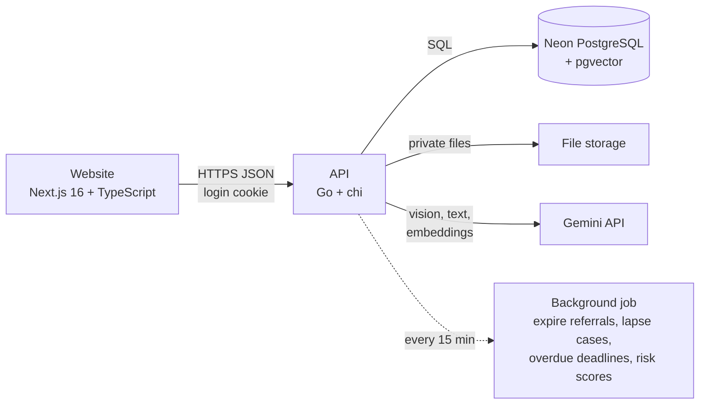

# Child Connect

**A secure helper for India's legal child adoption process.**
AI helps with paperwork, information and deadlines. A human always makes the final decision.

> Team **Puran Poli**, Thadomal Shahani Engineering College (TSEC), Mumbai
> Ideathon and Paper Presentation, SLRTCE Mira Road, 17 October 2026, AI/ML track

Child Connect works **alongside CARINGS**, the official government adoption website. It does not replace it, it never
shows children's names or photos, and its AI never ranks children or chooses a family.

---

## Contents

1. [What it does](#what-it-does)
2. [Quick start](#quick-start)
3. [Login accounts](#login-accounts)
4. [Demo walkthrough](#demo-walkthrough)
5. [AI and machine learning](#ai-and-machine-learning)
6. [Security and privacy](#security-and-privacy)
7. [Architecture](#architecture)
8. [Testing](#testing)
9. [Project structure](#project-structure)
10. [Documentation](#documentation)

---

## What it does

| For | Child Connect gives them |
|---|---|
| **Parents** (prospective adoptive parents) | A Case Tracker in simple words, legal deadline countdowns, instant AI checks on every uploaded document, and a rules assistant in English, Hindi and Marathi that quotes the exact regulation |
| **Agencies** (social workers, medical officers) | Cases sorted by deadline risk, document review next to the AI findings, a Report Co-Pilot that turns rough home-visit notes into the official report, and the Referral Lock |
| **Government officers** (admins) | A Deadline Radar with ML risk predictions and reasons, agency scorecards, child review alerts, agency approval, and a tamper-evident audit log |
| **Everyone** (no login) | Eligibility Checker, official Fee Card, Verify Agency, and Scam Shield against fake adoption posts |

---

## Quick start

**You need:** Go 1.22+, Node.js 20+, Python 3.9+ (only for tests and model training), and a Neon PostgreSQL database.

### 1. Configure the API

```bash
cd backend
cp .env.example .env
```

Fill in `backend/.env`:

| Setting | What to put |
|---|---|
| `DATABASE_URL` | Neon **pooled** connection string (host contains `-pooler`) |
| `DATABASE_URL_DIRECT` | Neon direct connection string (used for migrations) |
| `JWT_SECRET` | Any random text, at least 32 characters |
| `FIELD_ENCRYPTION_KEY` | 32 random bytes in base64, for example `python -c "import secrets,base64;print(base64.b64encode(secrets.token_bytes(32)).decode())"` |
| `GEMINI_API_KEY` | Your key from [aistudio.google.com/apikey](https://aistudio.google.com/apikey). Leave empty for rules-only mode |
| `GEMINI_MODEL` | `gemini-3.5-flash` |

> `.env` holds secrets and is ignored by git. Never commit it.

### 2. Load the starting data and run

On Windows PowerShell, from the repository root:

```powershell
.\scripts\reset-data.ps1        # creates the tables and loads the synthetic starting data
.\scripts\start-backend.ps1     # API     -> http://localhost:8080/api/v1
.\scripts\start-frontend.ps1    # website -> http://localhost:3000
```

Or by hand:

```bash
cd backend  && go run ./cmd/seed -reset && go run ./cmd/api
cd frontend && npm ci && npm run dev
```

The website needs `frontend/.env.local` with `NEXT_PUBLIC_API_URL=http://localhost:8080/api/v1` (the start script
creates it).

---

## Login accounts

All data is synthetic. **Password for every account: `ChildConnect@2026`**

| Role | Email | Who they are and what to try |
|---|---|---|
| Admin | `admin@childconnect.in` | Kavita Rao, state oversight officer: Deadline Radar, scorecard, child alerts, agency approval, knowledge base, scam reports, audit chain |
| Agency | `worker@childconnect.in` | Meera Kulkarni, social worker at Asha Shishu Griha, Thane: case review, Report Co-Pilot, children, referrals, legal steps, follow-ups |
| Agency | `doctor@childconnect.in` | Dr. Sunil Patil, medical officer at the same agency: medical summary approval |
| Agency | `nagpur@childconnect.in` | Navjeevan Bal Sadan, an agency still **waiting for admin approval** (blocked until approved) |
| Parent | `parent@childconnect.in` | Rahul and Priya Sharma: registered, 12 days left to upload documents |
| Parent | `parent2@childconnect.in` | Vikram and Anita Deshmukh: top of the waiting list, receives the referral |
| Parent | `parent3@childconnect.in` | Sanjay and Neha Joshi: documents submitted, ready for agency review |
| Parent | `parent4@childconnect.in` | Imran and Sana Shaikh: home study in progress (Report Co-Pilot) |
| Parent | `parent5@childconnect.in` | Arjun and Kavya Nair: adopted, follow-up visits running |

Run `scripts/reset-data.ps1` (with the API stopped) any time to go back to this exact starting state.

---

## Demo walkthrough

Sample files for every step are in [`sample-documents/`](sample-documents). All are marked SAMPLE and contain no
real person's data.

1. **Public tools.** Open `/eligibility`, enter a husband born 1982 and a wife born 1984: combined age 86 is over
   the limit of 85, so only children above 2 years are allowed, with the reason. Paste
   `sample-documents/scam_message.txt` into **Scam Shield**: verdict *Likely scam*.
2. **Parent: DocCheck AI.** Log in as `parent@`. In *Documents*, upload the rent agreement as residence proof
   (warning), then the electricity bill (passes), then the blurry photo (fails the image-quality check). Upload the
   rest and submit.
3. **Parent: Sahayak AI.** Ask *"What happens if I do not reserve the child?"*. The answer cites Regulation 9(3).
   Switch to Marathi or Hindi and ask again.
4. **Agency: document review.** Log in as `worker@`, open Sanjay and Neha Joshi, verify documents, and ask for a
   re-upload of the rent agreement with a reason.
5. **Agency: Report Co-Pilot.** Open Imran and Sana Shaikh, *Home Study Report* tab, paste
   `sample-documents/hsr_rough_notes.txt`, click *Draft with AI*, complete the missing section, choose *Suitable*,
   save and sign. The case moves to the waiting list.
6. **Agency: Referral Lock.** Open child **MH-THN-2026-0002**, draft and approve the medical summary, then
   *Find next parent* (seniority rules, no AI) and *Send referral*.
7. **Parent: 48-hour decision.** Log in as `parent2@`, open *Referral*: case code only, approved summary, reports,
   timer and the "1 of 3" warning. Reserve the child.
8. **Admin.** Log in as `admin@`: Deadline Radar, scorecard, child alerts, approve Navjeevan Bal Sadan, scam reports,
   and *Verify chain* in the audit log.

To record this walkthrough as a video: `python scripts/record_demo.py` (needs `pip install playwright imageio-ffmpeg`
and `python -m playwright install chromium`; writes `demo-video/child-connect-demo.mp4`).

---

## AI and machine learning

| Feature | How it works | Human control |
|---|---|---|
| **DocCheck AI** | SHA-256 duplicate check and blur check (variance of Laplacian) in Go, Gemini vision reads the document into fixed JSON, then rule checks in Go: allowed type, Jaro-Winkler name match (0.88), address match, bill under 3 months, doctor's registration number | Below 0.85 confidence is always *Needs human review*; the social worker verifies or asks for a re-upload |
| **Sahayak AI** | RAG: `gemini-embedding-001` (768) embeddings in pgvector, top 5 passages by cosine distance, answer only from those passages with citations, in en / hi / mr | Questions about the parent's own case are not answered; they are sent to the social worker |
| **Report Co-Pilot** | Home Study Report sections, follow-up reports with concern flags, simple medical summary for parents | Nothing is official until a human signs or approves; both the draft and the final text are kept |
| **Deadline Radar** | Logistic regression trained on 5,000 synthetic deadlines (scikit-learn), exported to `model.json`, scored in Go with the top 3 reasons | Shown as a prediction, never as a fact |
| **Scam Shield** | Warning-phrase rules in Go plus a Gemini classification; the stricter verdict wins | Reports go to the admin |

Every AI output is stored in `ai_runs` with the model, time taken and the human decision (accepted, edited or
rejected). Every Gemini call has a 20-second limit and one retry. **Without a Gemini key the app still works**:
each feature falls back to rules and labels its output `rules-only`.

Risk model on its synthetic test split: accuracy 0.734, precision 0.769, recall 0.802, ROC-AUC 0.799.

---

## Security and privacy

* Permission checks on **every request** on the server; refused attempts return 403 and are written to the audit log.
* Login with httpOnly, SameSite cookies (15-minute access, 7-day refresh); bcrypt cost 12; 5 failed logins lock the
  account for 15 minutes; rate limits on login, AI and Scam Shield.
* Child names and parent addresses encrypted with **AES-256-GCM**; only case codes are shown; only the last 4 digits
  of identity numbers are kept.
* Files are private; links are signed, expire after 5 minutes, and are created only after a permission check.
  The real file type is checked from its first bytes.
* **Audit log as a SHA-256 hash chain**, append-only in the database; *Verify chain* finds any changed entry.
* The legal status rules of the Adoption Regulations 2022 are enforced on the server (409 for any other change).

---

## Architecture



| Layer | Technology |
|---|---|
| Website | Next.js 16 (App Router), TypeScript, Tailwind CSS, TanStack Query, React Hook Form + Zod, next-intl (en / hi / mr), Recharts |
| API | Go, chi, pgx v5, goose migrations, golang-jwt, bcrypt, validator, strutil, Google GenAI SDK |
| Database | Neon PostgreSQL 18 with pgvector and pgcrypto |
| AI | Gemini Flash (`gemini-3.5-flash`), `gemini-embedding-001`, scikit-learn (offline training only) |

---

## Testing

| Test | Command | Result |
|---|---|---|
| End-to-end API (full adoption process, all roles, 14 security cases) | `python backend/tests/e2e_api.py` | 158 / 158 passed |
| Go unit tests (DocCheck on samples, blur, name matching) | `cd backend && go test ./...` | passed |
| Website checks | `cd frontend && npm run typecheck && npm run lint && npm test && npm run build` | passed |

The end-to-end test changes data, so run `scripts/reset-data.ps1` afterwards. Measured details, including speed and
bugs found during testing, are in [`docs/testing-report.md`](docs/testing-report.md).

---

## Project structure

```
backend/            Go API
  cmd/api           server entry point
  cmd/seed          synthetic starting data and sample documents
  internal/         auth, audit, crypto, storage, rules, workflow, ai, handlers, jobs
  migrations/       database schema
  ml/               synthetic data generator and risk model training
  tests/            end-to-end API test
frontend/           Next.js website (public, parent, agency and admin pages)
sample-documents/   synthetic files for testing uploads, reports and notes
scripts/            start, reset and demo-recording scripts
docs/               API contract, integration matrix, testing report
docs-src/           complete project guide and design system
```

---

## Documentation

* [Complete project guide](docs-src/allaboutourproject%20(1)%20(1).md): the problem, the law, every feature, schema and API
* [Backend README](backend/README.md): API details, AI modes, additions to the guide
* [Frontend README](frontend/README.md)
* [Frontend and backend contract](docs/frontend-backend-contract.md)
* [API integration matrix](docs/api-integration-matrix.md)
* [Testing report](docs/testing-report.md)

---

*AI never ranks children. A human always decides. Built to work alongside CARINGS.*
